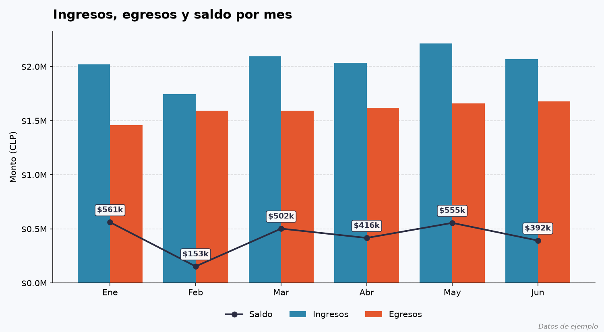

# Automatización de reporte mensual de ingresos y egresos

Script en Python que lee un libro de ingresos y egresos en Excel y genera automáticamente un resumen mensual, un total por categoría y un gráfico. Reemplaza una tarea que antes se hacía a mano en una planilla.



> Los datos del archivo de ejemplo son inventados y no corresponden a ninguna empresa real.

## Qué hace

1. Lee `libro_ingresos_egresos.xlsx` (fecha, categoría, tipo y monto de cada movimiento).
2. Calcula los ingresos, egresos y saldo de cada mes.
3. Calcula el total por categoría (ventas, arriendo, sueldos, insumos y servicios).
4. Exporta los resultados a `reporte_mensual.xlsx` (una hoja por tabla).
5. Genera `grafico_mensual.png` con ingresos, egresos y saldo por mes.

## Tecnologías

Python, pandas, openpyxl, matplotlib

## Cómo ejecutarlo

1. Instala Python 3 y las librerías:
   ```
   pip install pandas openpyxl matplotlib
   ```
2. Descarga los archivos del repositorio y déjalos en la misma carpeta.
3. Ejecuta:
   ```
   python Codigo.py
   ```
4. Se imprimen las tablas en pantalla, se abre el gráfico y se crean `reporte_mensual.xlsx` y `grafico_mensual.png` en la misma carpeta.

Para usar tus propios datos, reemplaza `libro_ingresos_egresos.xlsx` por un archivo con las mismas columnas: `fecha`, `categoria`, `tipo` (Ingreso o Egreso) y `monto`.

## Archivos

| Archivo | Descripción |
|---|---|
| `Codigo.py` | Script principal |
| `libro_ingresos_egresos.xlsx` | Datos de ejemplo (enero a junio de 2026) |
| `reporte_mensual.xlsx` | Reporte generado por el script |
| `grafico_mensual.png` | Gráfico generado por el script |

## Mi rol

Proyecto personal que desarrollé de forma individual: armé el archivo de datos de ejemplo, escribí el script y diseñé el gráfico.

## Estado

Proyecto académico y de práctica, 2026. Funciona con meses de enero a junio; para otros períodos hay que ajustar la lista de nombres de meses del gráfico.
